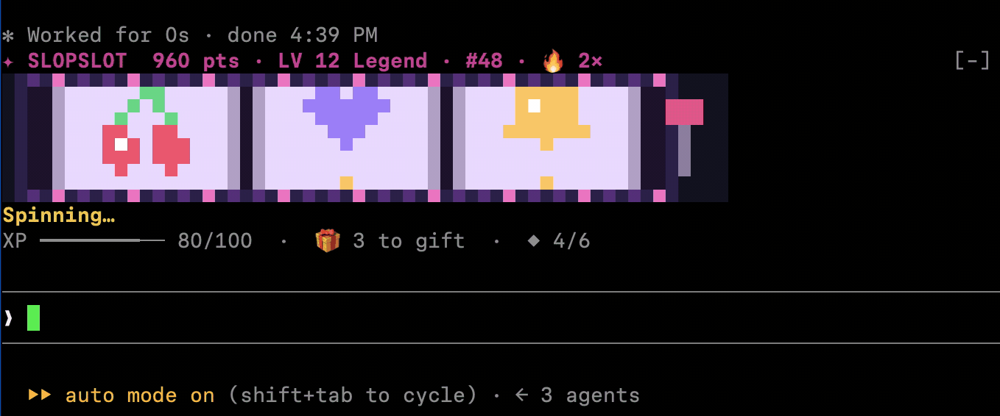
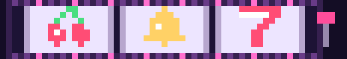

# SlopSlot

**A slot machine inside Claude Code.**

Every prompt pulls the lever: three reels
spin while Claude works, then stop one at a time. Collect points, climb the
ranks, unlock badges, and occasionally get paid for absolutely no skill.



## Give it a spin

You need **Claude Code 2.1.319 or later**. No dependencies, API keys, or build
step are required.

Install from your terminal:

```sh
claude plugin install slopslot --marketplace gajus/slopslot
```

Or run this inside Claude Code:

```text
/plugin install slopslot --marketplace gajus/slopslot
```

Start a new Claude Code session after installation. Accept any workspace or
plugin trust prompts Claude Code shows. Send a normal
prompt and the reels will spin automatically. For a spin without asking Claude
to do anything, run:

```text
/slopslot
```

Want the full machine?

```text
/slopslot cabinet
```

The cabinet opens in a pane, with a Spin button on wider displays. Close it
with Escape or its Close control to return to the display above your prompt.
Check `/plugin` → Installed if SlopSlot does not appear.

To update to a new release:

```sh
claude plugin update slopslot@gajus-slopslot
```

SlopSlot is distributed through the marketplace in
[`gajus/slopslot`](https://github.com/gajus/slopslot). It does not require npm.

## A little casino for your context window

- **Terminal:** original pixel sprites, scrolling reels, chasing lights, a
  moving lever, and reward sparkles.
- **Claude Desktop renderer:** a shaded SVG cabinet, illustrated symbols,
  and bouncing gold coins. Jackpots get a bigger celebration.
- **Progress:** an XP bar, rank titles, win streaks, a gift countdown, and six
  collectible badges.
- **Small screens:** a compact text display when there is not enough room for
  the artwork. `/slopslot cabinet` opens a separate view.



These images are artwork previews with example symbols and scores. The terminal
has been checked in a live Claude Code session. The Desktop renderer has been
checked through rendering tests and standalone previews, rather than a live
Desktop session. Both were developed against Claude Code **2.1.319**.

## Commands

| Command | What it does |
| --- | --- |
| `/slopslot` or `/slopslot spin` | Spin without a model request; also enables the machine. |
| `/slopslot cabinet` | Open the larger interactive cabinet. |
| `/slopslot rewards` | Show payout rules, badges, and unlock conditions. |
| `/slopslot status` | Show points, level, XP, badge count, and best spin. |
| `/slopslot off` | Hide the machine, close the cabinet, and stop automatic spins. |
| `/slopslot on` | Show the machine and resume automatic spins. |
| `/slopslot reset` | Clear session progress and cancel an unfinished spin. |

## The extremely serious economy

Each reel independently picks one of six equally likely symbols: cherries,
lemon, grapes, bell, star, or seven.

| Result | Base points |
| --- | ---: |
| A pair | 10 |
| Three matching symbols | 50 |
| Three sevens | 100 |

Consecutive matching spins multiply the base payout: **×1 → ×2 → ×3**. The
multiplier stays at ×3 until a miss resets the streak. It applies to base
points only; bonuses are added afterward.

Every completed spin earns **20 XP**, plus **10 extra XP** for matching reels.
Every 100 XP earns a new level and **25 bonus points**. Every fifth completed
spin adds a **25-point gift**. Even a miss moves you forward.

Rank titles advance every two levels:
**Rookie → Regular → High roller → VIP → Legend**.

### Badge collection

Each badge pays once per session. One spin can unlock multiple badges.

| Badge | Unlock | Bonus points |
| --- | --- | ---: |
| First pull | Finish a spin | 5 |
| Double trouble | Match two reels | 15 |
| Triple threat | Match all three reels | 50 |
| Lucky sevens | Land three sevens | 100 |
| On fire | Win three spins in a row | 30 |
| Rising star | Reach level 3 | 50 |

Spins are free. Points have no monetary value. Your only real prize is having
installed a slot machine in your coding assistant.

## What happens to your prompts and progress?

SlopSlot runs locally. It makes no network requests, model calls, or file
writes, and adds no text to your prompts or conversation. A spin starts
immediately without waiting for the reels to finish before letting your prompt
continue.

Progress lives in memory and resets when the plugin reloads or the session
restarts. Sending another prompt during a spin settles that result before
starting the next one. Reset cancels an unfinished spin without awarding it.

Reels stop after two seconds. Reward animations last another 1.2 seconds, then
stop repainting. Turning SlopSlot off cancels its timers and leaves other mods'
prompt content visible.

## Development

Clone the repository and load your working copy for one session:

```sh
git clone https://github.com/gajus/slopslot.git
cd slopslot
claude --plugin-dir .
```

Validate the plugin and run its tests:

```sh
claude plugin validate .
claude plugin test
```

The test suite covers scoring, streaks, bonuses, badge unlocks, prompt
passthrough, timer cleanup, controls, and both graphical renderers.

Claude Code watches a folder loaded with `--plugin-dir` and reloads changes.
Reloading also resets SlopSlot's session progress.

| File | Purpose |
| --- | --- |
| `.claude-plugin/plugin.json` | Plugin name and version |
| `.claude-plugin/marketplace.json` | Marketplace catalog for installation from GitHub |
| `hooks/hooks.json` | Hooks module entry point |
| `hooks/register.js` | Prompt hooks, animation timers, commands, and UI |
| `hooks/art.js` | Terminal pixel art and Desktop SVG artwork |
| `hooks/rewards.js` | Scoring and progression |
| `tests/` | Rendering, integration, and reward tests |
| `previews/` | Example cabinet artwork |
